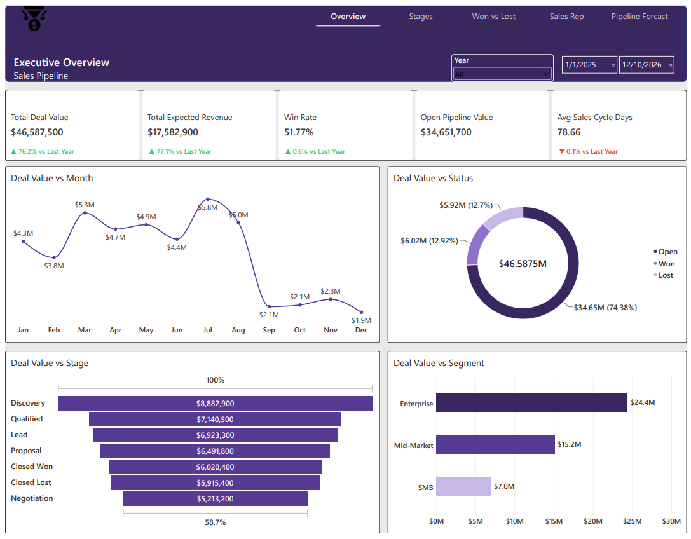

# Sales Pipeline Performance & Forecast Analysis

A Power BI project analyzing a B2B SaaS sales pipeline of 2,212 deals: how healthy the pipeline really is, where deals get stuck, why deals are won or lost, how each sales rep performs, and what revenue the business can realistically expect to close.

> The dataset is simulated. The findings show how the analysis works, not the results of a real company.

---

## Business Scenario

A B2B SaaS company sells four products (Analytics Platform, CRM Suite, Marketing Automation, Data Integration) across five regions and three customer segments. Leadership can see a large pipeline in the CRM but cannot tell how much of it is real.

## Objective

Assess pipeline health, identify stage drop-offs, understand won and lost patterns, evaluate sales rep performance, and quantify the weighted pipeline.

## Business Problem

The pipeline totals **$46.59M across 2,212 deals**, but only **$17.58M** is realistically expected once each deal is weighted by its probability of closing. **75% of the pipeline value ($34.65M across 1,592 deals) is still open and unresolved.** Win rate is 51.8% overall but changes by segment, region and product, and there was no single view connecting stage progress, loss reasons and rep performance to a trustworthy forecast.

---

## Dataset

| Sheet | Description |
|---|---|
| Sales_Pipeline | 2,212 deals, 20 columns, one row per deal |
| Metadata | Data dictionary for every column |
| Case_Brief | The business brief the project answers |

**Period covered:** deals created between January 2025 and August 2026.

**Key fields:** Deal_Stage, Deal_Status (Open, Won, Lost), Deal_Value_USD, Probability, Expected_Revenue_USD (value × probability), Created_Date, Won_Date, Lost_Reason, Sales_Rep, Customer_Segment, Region, Product, Lead_Source, Meetings_Held, Emails_Sent, Sales_Cycle_Days.

**Known gaps (by design):** Industry has 26 blanks, Lead_Source has 22, Lost_Reason exists only for lost deals, and Sales_Cycle_Days is blank for open deals.

---

## Tools Used

- **Power BI**: modeling, measures and dashboard
- **DAX**: all KPIs, time intelligence and conditional formatting
- **Power Query**: loading and shaping the data
- **Excel**: source data review

<!-- Add SQL Server / PostgreSQL here if you used SQL for the cleaning or analysis layer -->

---

## Project Files

| File | Description |
|---|---|
| [Sales Pipeline Value.pbix](Sales%20Pipeline%20Value.pbix) | Power BI report with the data model, DAX measures and dashboard |
| [Sales Pipeline Value.pdf](Sales%20Pipeline%20Value.pdf) | PDF export of the dashboard |
| [sales_pipeline_data.xlsx](sales_pipeline_data.xlsx) | Source dataset |
| PNG files | Screenshots of each dashboard page, shown below |

---

## Process

### 1. Data Understanding
Read the Metadata and Case_Brief sheets, confirmed what each column means, checked nulls and duplicates, and confirmed which blanks are expected (open deals have no cycle time, only lost deals have a lost reason).

### 2. Data Modeling
The pipeline export is naturally one wide table, because industry, segment, region, rep, source and product are attributes of the deal itself, so I kept it as a single fact table with one dimension:

- **Fact_Sales_Pipeline**: one row per deal
- **Dim_Calendar**: a dynamic date table, marked as the official Date Table
- **Created_Date → Dim_Calendar** is the active relationship
- **Won_Date → Dim_Calendar** is inactive, and `USERELATIONSHIP()` switches it on for revenue-by-close-date measures

### 3. DAX Measure Development
1. **Core measures**: total deals, total deal value, expected revenue, won/lost/open deals and value, win rate, average sales cycle, average deal value, meetings and emails
2. **Pipeline quality**: expected revenue ÷ deal value, plus a dynamic health verdict and banner colour
3. **Stage measures**: deals by stage and the reached-stage funnel measures
4. **Won vs lost measures**: cycle time for won and lost deals, top lost reason
5. **Rep measures**: total reps, deals per rep, meetings per deal, top rep by win rate, status icon
6. **Time intelligence**: single-measure YoY with an arrow icon, formatted percentage and label, paired with green/red colour measures

### 4. Funnel Approach
`Deal_Stage` shows where a deal sits today, so charting those counts as a funnel gave an impossible 120.2% conversion (321 won from 267 leads). The fix was to count every deal that reached each stage, meaning the deals now at that stage or any later one. This makes the funnel narrow properly.

| Stage | Deals that reached it | Share of previous stage |
|---|---|---|
| Lead | 1,913 | |
| Qualified | 1,646 | 86.0% |
| Discovery | 1,327 | 80.6% |
| Proposal | 923 | 69.6% |
| Negotiation | 575 | 62.3% |
| Closed Won | 321 | 55.8% |

Lost deals are excluded because the data does not record the stage at which they were lost.

### 5. Dashboard Design
Five pages, each built around one business question, with slicers limited to what matters on that page.

---

## Dashboard Pages

### Page 1: Overview
*Answers: Is the pipeline healthy, or inflated?*

KPI cards for deal value, expected revenue, win rate, open pipeline value and sales cycle, a dynamic health verdict banner, deal value trend (raw vs weighted), the open/won/lost split, and pipeline value by stage and segment.

### Page 2: Funnel & Stage Drop-off Analysis
*Answers: Where are deals getting stuck?*

The reached-stage funnel from lead to closed won, deal counts and values by stage, and stage conversion.

### Page 3: Won vs Lost Analysis
*Answers: Why do deals win or lose, and does it differ by segment, region or source?*

Win rate by segment, region and lead source, lost reason breakdown, and sales cycle length for won vs lost deals, with YoY change.

### Page 4: Sales Rep Performance
*Answers: Which reps convert, and does activity translate into wins?*

A rep table (deals, won, lost, win rate, won revenue, cycle time) with status icons, plus win rate and won revenue by rep.

### Page 5: Weighted Pipeline & Forecast
*Answers: What can we realistically expect to close, and from where?*

Expected revenue by stage, segment and product, deal value against expected revenue, and the expected revenue trend with YoY change.

---

## Key Findings

- **Raw pipeline overstates reality.** $46.59M total pipeline against $17.58M expected revenue, a quality ratio of about 38%.
- **Most of the pipeline is unresolved.** 75% of the value ($34.65M) sits in 1,592 open deals.
- **Win rate is 51.8%** (321 won, 299 lost), but the biggest deals are the hardest: Enterprise deals average about $54.5K and win 48.1% of the time, while Mid-Market wins 54.6%.
- **Region and product matter.** Win rates run from roughly 43% in Asia Pacific to 56–58% in the UK & Ireland and Europe, and from about 47% for CRM Suite to about 58% for Data Integration.
- **Deals mostly die from silence, not product.** Lost contact (49), timing (49) and no decision (38) account for 136 of 297 recorded loss reasons. Price, competitor, feature gap and poor fit are each smaller.
- **Activity alone doesn't predict wins.** Won deals averaged 3.6 meetings against 3.5 for lost deals, and email counts were similar across all outcomes.
- **Late stages leak most.** The weakest handoffs in the funnel are Proposal to Negotiation (62.3%) and Negotiation to Closed Won (55.8%).

## Recommendations

- **Forecast on weighted pipeline, not raw pipeline,** and track the quality ratio as a standing KPI.
- **Build a re-engagement process for stalled deals,** since lost contact, timing and no decision are the largest loss reasons.
- **Tighten qualification and support for Enterprise deals,** which are the largest in value but win least often.
- **Review the Proposal and Negotiation stages,** where the funnel narrows most.
- **Investigate Asia Pacific and CRM Suite,** the lowest-converting region and product, before adding pipeline there.

---

## Limitations

- **The data is simulated,** so the figures illustrate method, not a real business.
- **Stages are a snapshot.** There is no stage history, so the reached-stage funnel assumes deals did not skip stages.
- **Open deals are still in progress,** so late-stage conversion is understated until those deals resolve.
- **Lost deals have no recorded loss stage,** so they cannot be placed in the funnel.

---

## Author

**Olumide David Faleye**
Data Analyst / BI Analyst
GitHub: [github.com/Olumidave](https://github.com/Olumidave)
